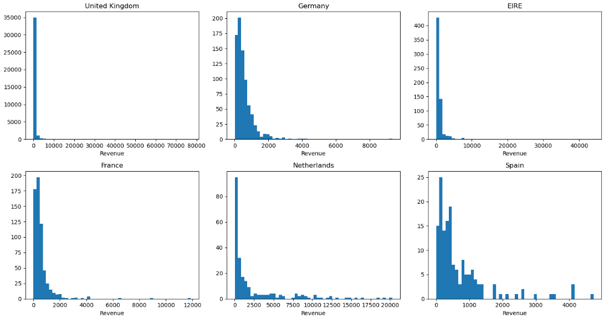
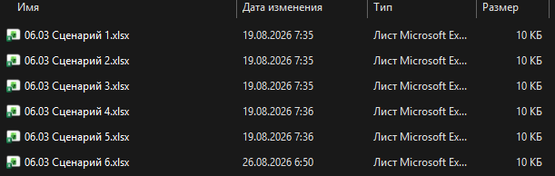
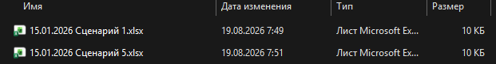
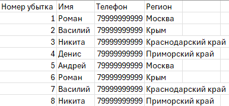
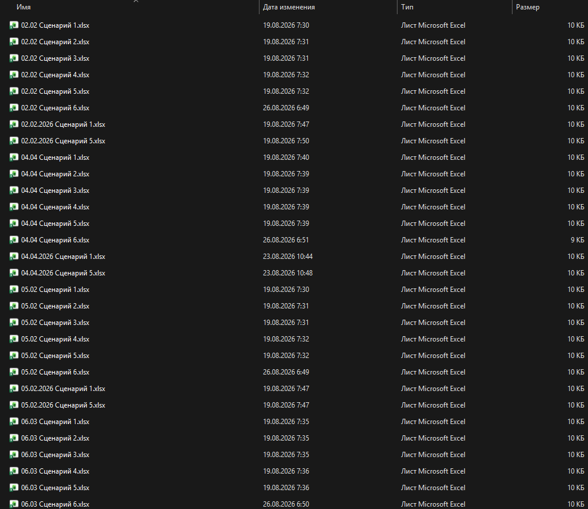
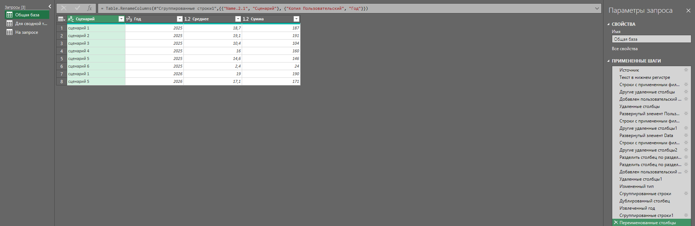
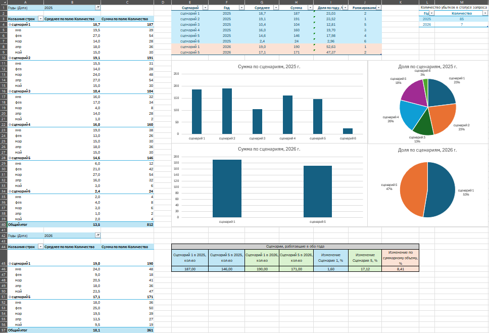
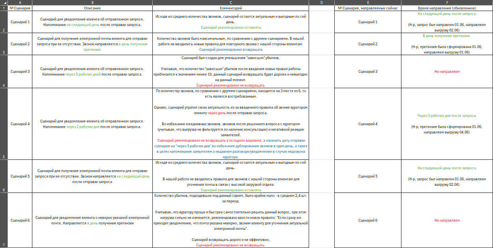
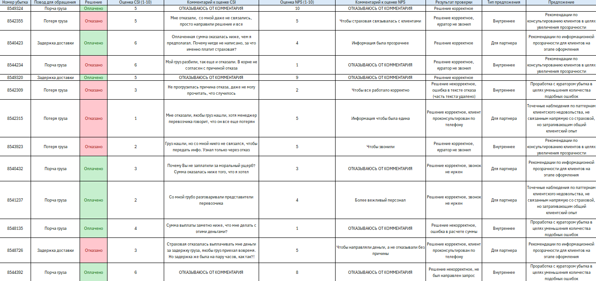

# Портфолио аналитика
 
**Пономарев Данил Андреевич**, бизнес-аналитик, Москва
Резюме на hh.ru: https://hh.ru/resume/ba567a1aff1122118c0039ed1f31485558324e
Связаться: [Telegram] · [почта]
 
Работаю в крупной страховой компании. Кроме основных задач там автоматизирую рутину и помогаю аналитикам с данными. Здесь три проекта: один учебный на открытых данных (SQL, Python, статистика, Power BI) и два с реальной работы (Excel и Power Query). В рабочих кейсах данные, названия и правила заменены на вымышленные, а методика настоящая.
 
## Коротко о главном
 
**Кейс 1. Клиентская база интернет-магазина** (учебный, ~1 млн транзакций)
- Меньше 15% клиентов (14,9%) приносят 61,6% выручки. Ещё четверть клиентов даёт всего 2,3%.
- Медианный чек в Великобритании 300, в остальных пяти странах от 392 до 696. Разница не случайна: критерий Краскела–Уоллиса, p ≈ 5×10⁻¹³⁴.
- Выручка сезонная: пик в ноябре в оба года. В феврале–апреле 2011 она была ниже прошлогодней (до −14,4%).
- В данных нашёл и убрал аномалии: счета с отрицательной выручкой и один счёт на 80 995 штук одного товара.
**Кейс 2. Колл-центр на аутсорсе** (рабочий проект, данные вымышлены)
- Из шести сценариев обзвона четыре были отключены, и нагрузка на колл-центр за январь–май упала с 812 до 361 контакта (−55%).
- Рекомендации: один сценарий вернуть, один изменить, два оставить, два не возвращать. Потенциал: до +351 контакта (≈712, это 88% прежнего уровня).
- Проверил, что спрос не пропал: у двух сценариев, которые работали в оба года, объём вырос на 8,4% (333 → 361).
- В реальном проекте данные собирались из нескольких тысяч файлов, а руководство приняло рекомендации с небольшими правками.
**Кейс 3. Клиентские оценки CSI и NPS** (рабочий проект, данные вымышлены)
- Разобрал 67 обращений с низкими оценками, предложил 23 улучшения, более 10 из них приняты руководством.
- Главная находка: в большинстве случаев решение по обращению было верным, а клиент всё равно был недоволен из-за общения и непонятной информации. Поэтому почти все предложения про коммуникацию и прозрачность, а не про исправление решений.
Ниже каждый кейс подробно: как делал, где споткнулся и что получилось.
 
## Содержание
 
1. [Кейс 1. Клиентская база интернет-магазина](#кейс-1-клиентская-база-интернет-магазина)
2. [Кейс 2. Колл-центр на аутсорсе](#кейс-2-колл-центр-на-аутсорсе)
3. [Кейс 3. Клиентские оценки CSI и NPS](#кейс-3-клиентские-оценки-csi-и-nps)
4. [Что лежит в репозитории](#что-лежит-в-репозитории)
---
 
## Кейс 1. Клиентская база интернет-магазина
 
Учебный проект на открытых данных. Стек: SQL (MySQL), Python (pandas, scipy, matplotlib), Power BI.
 
Я взял датасет [Online Retail II](https://archive.ics.uci.edu/dataset/502/online+retail+ii) (UCI ML Repository): реальные продажи британского интернет-магазина подарочных товаров с декабря 2009 по декабрь 2011, около миллиона строк. Выбрал его специально, потому что данные там неидеальные. Чистить их приходится по-настоящему, как и на работе. Покупатели магазина в основном оптовые.
 
### Задача
 
Понять, какие клиенты приносят магазину деньги, правда ли, что средний чек отличается между странами, и как выручка меняется в течение года.
 
### Что не так с данными
 
- у части строк нет номера клиента;
- есть служебные корректировки с отрицательной ценой при положительном количестве;
- последний месяц неполный: в данных всего 9 дней декабря 2011.
### Шаг 1. SQL
 
Я сделал три выгрузки под три задачи: выручка по счетам и странам, выручка по месяцам и база для RFM-анализа по клиентам. Самая интересная из них последняя. Давность последней покупки и сумму трат я считаю оконными функциями, а число заказов вынес в отдельный CTE. MySQL не разрешает `DISTINCT` внутри оконной функции, а считать нужно именно уникальные заказы: в одном заказе может быть десяток строк.
 
```sql
with customer_revenue as
(select * from online_retail
 where Quantity > 0 and `Customer ID` is not null and Price > 0),
freq as
(select `Customer ID`, count(distinct Invoice) as F
 from customer_revenue
 group by `Customer ID`),
t as
(select `Customer ID`, InvoiceDate,
        max(InvoiceDate) over () as max_d,
        max(InvoiceDate) over (partition by `Customer ID`) as customer_m_d,
        sum(Quantity * Price) over (partition by `Customer ID`) as M
 from customer_revenue)
select distinct t.`Customer ID`,
       TIMESTAMPDIFF(DAY, t.customer_m_d, t.max_d) as R,
       freq.F,
       t.M
from t
join freq on t.`Customer ID` = freq.`Customer ID`
```
 
Условие `Price > 0` я добавил уже позже, когда при проверке статистики наткнулся на строки с отрицательной ценой (расскажу ниже). Они занижали бы сумму трат клиентов.
 
### Шаг 2. RFM-сегментация
 
RFM описывает каждого клиента тремя числами: когда он покупал в последний раз (Recency), как часто покупает (Frequency) и сколько потратил (Monetary). Каждую метрику я разбил на оценки от 1 до 5 через квантили (`pd.qcut`). С частотой пришлось повозиться: очень многие клиенты купили всего один раз, и границы квантилей совпадали, поэтому я использовал `duplicates='drop'`.
 
Первая версия сегментов получилась слабой. Правил было четыре, и 42,9% клиентов попали в «Прочие». Для бизнеса такой сегмент почти ничего не значит.
 
```python
def segment(x):
    r, f, m = x['R_score'], x['F_score'], x['M_score']
    if r >= 4 and f >= 4 and m >= 4:
        return 'Лояльные'
    elif r <= 2 and f >= 4 and m >= 4:
        return 'В зоне оттока'
    elif r >= 4 and f <= 2:
        return 'Новые'
    elif r <= 2 and f <= 2 and m <= 2:
        return 'Потерянные'
    else:
        return 'Прочие'
```
 
Тогда я добавил промежуточные сегменты, чтобы у каждой группы был понятный смысл:
 
```python
def segment(row):
    r, f, m = row['R_score'], row['F_score'], row['M_score']
    if r >= 4 and f >= 4 and m >= 4:
        return 'Лояльные'
    elif r <= 2 and f >= 4 and m >= 4:
        return 'В зоне оттока'
    elif r <= 2 and f >= 3 and m >= 3:
        return 'Уходящие'
    elif r >= 4 and f <= 2 and m >= 3:
        return 'Новые с высоким чеком'
    elif r >= 4 and f <= 2:
        return 'Новые'
    elif r <= 2 and f <= 2 and m <= 2:
        return 'Потерянные'
    elif f >= 4 and m <= 2:
        return 'Частые с низким чеком'
    elif r == 3 and f == 3 and m == 3:
        return 'Стабильные средние'
    else:
        return 'Прочие'
```
 
| Сегмент | Доля клиентов | Доля выручки |
|---|---|---|
| Лояльные | 14,9% | **61,6%** |
| Прочие | 38,3% | 24,5% |
| Потерянные | 25,0% | 2,3% |
| Новые с высоким чеком | 8,2% | 4,5% |
| Новые | 7,9% | 0,9% |
| Уходящие | 3,5% | 2,6% |
| В зоне оттока | 1,1% | 3,2% |
| Стабильные средние | 1,0% | 0,3% |
| Частые с низким чеком | 0,1% | 0,0% |
 
«Прочих» стало 38,3%. Это всё ещё много, и ниже я пишу, что бы с этим сделал.
 
Главное: меньше 15% клиентов дают 61,6% выручки, а четверть базы («потерянные») приносит всего 2,3%. Значит, удерживать нужно в первую очередь лояльных, а не всех подряд.
 

 
### Шаг 3. Статистика: различается ли средний чек между странами
 
Вопрос простой: чек в разных странах действительно разный или мне так кажется? Я взял шесть стран с наибольшим числом заказов. Нулевая гипотеза: медианный чек во всех странах одинаковый.
 
**Странный график.** Когда я построил гистограммы чека по странам, график по Великобритании выглядел неправильно: ось растянулась от −50 000 почти до 170 000, хотя типичный чек около 300. Пришлось разбираться, и нашлось две причины:
 
1. Часть счетов имела отрицательную выручку. Это служебные корректировки, а не продажи. Я их исключил (`Revenue > 0`).
2. Счёт № 581483 состоял из одной позиции («PAPER CRAFT, LITTLE BIRDIE») на 80 995 штук, это около 168 тысяч выручки. Я проверил его в SQL: другого товара в счёте нет. Настоящий опт обычно размазан по многим позициям, так что я счёл это ошибкой ввода и убрал счёт из анализа.

 
**Выбор теста.** Сначала проверил, подходит ли классический ANOVA. Тест Левена показал, что разброс в странах сильно разный (statistic = 80,55, p ≈ 2,1×10⁻⁸⁴), так что ANOVA не подходит. Я взял его непараметрический аналог, критерий Краскела–Уоллиса. Он тоже показал различие (statistic = 630,49, p ≈ 5,2×10⁻¹³⁴): минимум в одной стране медиана чека отличается от остальных.
 
Чтобы понять, в каких именно, я применил пост-хок тест Данна с поправкой Бонферрони. Великобритания отличается от всех остальных стран. Германия, Франция и Испания по чеку ближе друг к другу.
 
| Страна | Медиана | Среднее | Кол-во заказов |
|---|---|---|---|
| United Kingdom | 300,41 | 484,55 | 36 535 |
| EIRE | 696,43 | 1 061,39 | 626 |
| Netherlands | 607,19 | 2 430,84 | 228 |
| Spain | 432,89 | 708,95 | 154 |
| Germany | 392,88 | 546,59 | 789 |
| France | 392,15 | 573,87 | 622 |
 
Похоже, что в Великобритании магазин работает как розница (много небольших заказов), а в остальных странах как опт. Но это моя гипотеза: данных о том, кто покупатель, в наборе нет.
 
С Нидерландами осторожнее: заказов там всего 228, а среднее почти в четыре раза выше медианы (несколько очень крупных заказов тянут его вверх). Поэтому я сравнивал именно медианы.
 
### Шаг 4. Тренд и сезонность
 
Я построил помесячную выручку и наложил два года друг на друга по номеру месяца. Декабрь 2011 убрал, потому что в данных только 9 дней, и на графике он выглядел бы как обвал.
 

 
Оба года повторяют одну форму: минимум в феврале, рост с сентября и пик в ноябре. При этом по сравнению с прошлым годом рост неравномерный. В феврале–апреле 2011 выручка была ниже, чем в 2010 (до −14,4%), лето и сентябрь выросли заметнее (до +18,6%), а в октябре и ноябре рост был скромным, около 2–3%. То есть бизнес рос не ровно, а немного усилил сезонный пик в конце года.
 
### Дашборд
 

 
На дашборде три цифры (выручка, число клиентов, доля выручки от лояльных), тренд с прогнозом, сегменты RFM (доля клиентов рядом с долей выручки) и сравнение стран по медиане и среднему вместе с результатом теста. Оговорки про неполный декабрь и маленькую выборку по Нидерландам вынесены прямо на экран. Прогноз построен всего на двух полных сезонных циклах, поэтому доверительный интервал я оставил широким намеренно.
 
Файл дашборда: `case.pbix` (открывается в Power BI Desktop).
 
### Что бы я предложил бизнесу
 
- Тратить усилия на удержание в первую очередь на «лояльных»: это 15% клиентов и больше 60% выручки.
- Не вести Великобританию и остальные страны одной политикой: чек и поведение покупателей там разные.
- Готовиться к сезону заранее: рост начинается уже в сентябре, а пик приходится на ноябрь.
### Ограничения
 
- Сегмент «Прочие» всё ещё занимает 38,3% клиентов. С большим временем я бы дробил его дальше или попробовал кластеризацию (например, k-means по трём метрикам) вместо ручных порогов.
- По Нидерландам выборка маленькая и разброс большой, выводы по ним осторожные.
- Прогноз в Power BI опирается на два сезонных цикла. Это минимум для таких методов.
### Как воспроизвести
 
Данные скачиваются по [ссылке выше](https://archive.ics.uci.edu/dataset/502/online+retail+ii). SQL-запросы лежат в папке `sql`, весь код с выводом каждой ячейки в [notebook.ipynb](notebook.ipynb).
 
---
 
## Кейс 2. Колл-центр на аутсорсе
 
Рабочий проект. Стек: Excel и Power Query.
 
> **О данных.** Все данные, названия сценариев, цифры и правила в этом кейсе вымышлены и собраны только ради того, чтобы показать методику. Реальный проект охватывал несколько тысяч файлов. Рабочие данные и условия работы с подрядчиком я не раскрываю по причине конфиденциальности.
 
### Задача
 
Каждый день в колл-центр на аутсорсе уходят выгрузки: списки людей, которым нужно позвонить по определённому сценарию (на работе мы называли их скриптами). Сценарии бывают двух видов: уведомить клиента об отправленном запросе или узнать его электронную почту, чтобы запрос вообще можно было отправить. Колл-центр оплачивается, поэтому его мощности должны загружаться с пользой.
 
Часть сценариев в какой-то момент отключили, но что из-за этого изменилось, никто не посчитал. Моя задача была собрать данные по всем выгрузкам за 2025 и 2026 годы, сравнить сопоставимые периоды и решить по каждому сценарию, возвращать его, оставлять или менять.
 
### Как устроены данные
 
Один файл Excel — один сценарий за один день отправки. Внутри четыре колонки: номер убытка, имя, телефон, регион. Одна строка — один человек, которому нужно позвонить. Файлы лежат в папках по датам.
 
| 2025: в один день уходило 6 файлов | 2026: остались только 2 |
|---|---|
|  |  |
 

 
### Проблема: данные выгружали по-разному
 
Файлов много (в реальном проекте их несколько тысяч), и выгружались они в разное время и немного по-разному. Самое наглядное: у файлов 2025 года в имени нет года, у файлов 2026 он есть.
 

 
В реальных выгрузках были ещё и отличия в столбцах: где-то лишние колонки, где-то другой порядок. Приводить каждый файл к одному виду вручную при таком объёме нереально.
 
### Решение: опереться на то, что есть всегда
 
Вместо того чтобы выравнивать все столбцы, я нашёл то, что гарантированно есть в каждом файле:
 
- внутри таблицы всегда есть номер убытка;
- в имени файла всегда есть дата и номер сценария.
Поэтому из каждого файла я оставил только три вещи: номер убытка, сценарий и дату. Остальное в анализе не нужно.
 
Всё это собрано одним запросом Power Query, который читает папку целиком. Ключевые шаги (полный код лежит в папке `powerquery`):
 
```m
// 1. Читаем все файлы папки и отбрасываем временные файлы Excel (~$...)
Источник = Folder.Files("<путь к папке>\Сценарии\Общая база"),
#"Строки с примененным фильтром" =
    Table.SelectRows(#"Текст в нижнем регистре", each not Text.StartsWith([Name], "~$")),
 
// 2. Делим имя файла по первому пробелу: «02.02» | «сценарий 1.xlsx»
#"Разделить столбец по разделителю" = Table.SplitColumn(...,
    Splitter.SplitTextByEachDelimiter({" "}, QuoteStyle.Csv, false), {"Name.1", "Name.2"}),
 
// 3. У файлов 2025 года в имени нет года (02.02): достраиваем его
#"Добавлен пользовательский объект1" = Table.AddColumn(..., "Пользовательский",
    each if Text.Length([Name.1]) = 5 then [Name.1] & ".2025" else [Name.1]),
 
// 4. Считаем строки: сколько контактов ушло по каждому сценарию в каждый день
#"Сгруппированные строки" = Table.Group(..., {"Name.2.1", "Пользовательский"},
    {{"Количество", each Table.RowCount(_), Int64.Type}})
```
 

 
Одно допущение стоит назвать прямо: файл без года в названии я считаю файлом 2025 года. Для этих данных это верно, но в другой структуре папок такое правило пришлось бы пересмотреть.
 
### Ловушка со сроками
 
Данные 2026 года есть только по май включительно. Если сравнить пять месяцев 2026 с полным 2025 годом, любой сценарий «потеряет» половину объёма просто из-за длины периода. Поэтому в обоих годах я сравнивал одни и те же месяцы, с января по май.
 
### Что показали цифры
 
Для каждого сценария я посчитал среднее число контактов за день отправки и сумму за период.
 

 
| Сценарий | 2025: среднее / сумма | 2025: доля | 2026: среднее / сумма |
|---|---|---|---|
| Сценарий 1 | 18,7 / 187 | 23,0% | 19,0 / 190 |
| Сценарий 2 | **19,1 / 191** | 23,5% | отключён |
| Сценарий 3 | 10,4 / 104 | 12,8% | отключён |
| Сценарий 4 | 16,0 / 160 | 19,7% | отключён |
| Сценарий 5 | 14,6 / 146 | 18,0% | 17,1 / 171 |
| Сценарий 6 | 2,4 / 24 | 3,0% | отключён |
| **Итого** | **812** | | **361** |
 
В 2026 году работают только сценарии 1 и 5, и нагрузка делится между ними почти пополам. В сумме колл-центр получает на 55% меньше контактов, чем в прошлом году.
 
### Решение по каждому сценарию
 
Объём важен, но решать только по нему нельзя: нужно ещё смотреть, что изменилось вокруг сценария.
 

 
| Сценарий | Решение | Почему |
|---|---|---|
| **1** | Оставить | Стабильный объём, в 2026 даже немного вырос |
| **2** | **Вернуть** | Самый большой объём из всех, а правил, которые бы его заменили, не вводилось |
| **3** | Не возвращать | Он нужен был против «зависших» убытков, а их стало меньше 10 (85 в 2025 против 7 в 2026). Возвращать дороже, чем выгода |
| **4** | **Вернуть в изменённом виде** | Был третьим по объёму, но куратор теперь сам звонит клиенту на следующий день, и звонки задваивались. Предложил сдвинуть отправку на 3-й рабочий день: тогда она напомнит о недавнем разговоре и сработает, если куратор не дозвонился |
| **5** | Оставить | Объём растёт: в 2026 он на 17% выше |
| **6** | Не возвращать, заменить правилом | В среднем 2,4 контакта за день: куратору быстрее и проще позвонить самому, чем держать отдельный сценарий |
 
### Как я проверил, что спрос не исчез
 
Главный риск в таком анализе: объём выключенных сценариев в 2025 году мог держаться на потоке обращений, которого в 2026 уже нет. Тогда «вернуть» значило бы вернуть пустоту.
 
Проверить это можно по сценариям 1 и 5: они работали в оба года, и я использовал их как контрольные. Их суммарный объём за январь–май не упал, а вырос на 8,4% (333 → 361 контакт). Значит, поток обращений остался прежним, и оценивать спрос по 2025 году разумно.
 
### Что это даёт
 
Если поток обращений прежний, возврат сценария 2 добавит до 191 контакта (+53% к текущей нагрузке), а изменённый сценарий 4 ещё до 160. В сумме нагрузка могла бы вернуться к ≈712 контактам, это около 88% уровня 2025 года. Это оценка сверху: объём изменённого сценария 4 может отличаться от прежнего.
 
В реальном проекте руководство приняло рекомендации с небольшими правками.
 
### Ограничения
 
- Оценка потенциала держится на предположении, что поток обращений остался прежним. Контрольные сценарии его поддерживают, но не доказывают.
- Я сравнивал объёмы, но не учитывал стоимость звонка и то, насколько звонок помогает. Следующим шагом добавил бы стоимость и долю контактов, после которых клиент действительно отвечает на запрос.
- Решения основаны на описательных показателях, без статистических тестов и контрольной группы. Здесь важнее было быстро дать практичную рекомендацию, чем строго доказать причинность.
- Путь к папке в запросе Power Query прописан жёстко. В следующей версии вынес бы его в параметр, чтобы запрос запускался на любом компьютере без правки кода.
---
 
## Кейс 3. Клиентские оценки CSI и NPS
 
Рабочий проект. Стек: Excel.
 
> **О данных.** Все данные в таблице ниже (номера убытков, комментарии клиентов, решения, предложения) вымышлены и сделаны только для иллюстрации методики. Реальные данные компании и партнёров я не раскрываю по причине конфиденциальности.
 
### Задача
 
Раз в месяц партнёр присылает выгрузку клиентских оценок: **CSI** (насколько клиент доволен решением по своему случаю) и **NPS** (порекомендует ли он нас другим), плюс короткую выжимку того, что клиент сказал в телефонном опросе. Низкой я считал оценку от 1 до 6 включительно.
 
Низкая оценка похожа на температуру: она говорит, что что-то не так, но не говорит что. Моя работа была выяснить причину и решить, что с ней делать.
 
### Как проходил разбор
 
1. **Фильтр.** Отбирал случаи, где CSI или NPS попадает в диапазон 1–6.
2. **Что говорит клиент.** Читал комментарий и искал в нём реальную претензию. Часто она не совпадала с оценкой.
3. **Расследование.** Открывал сам случай и смотрел всё: кто куратор, историю изменений, какие запросы направлялись, были ли звонки, что клиент предоставил с самого начала. В спорных случаях слушал запись звонка, чтобы понять, чья версия верна.
4. **Вердикт.** Решал, была ли ошибка с нашей стороны, и записывал нейтральной формулировкой.
5. **Предложение.** Решал, что с этим делать и кому это адресовать.
### Куда уходит предложение
 
| Ситуация | Куда адресуется |
|---|---|
| Ошибка в обработке случая | **Внутреннее** предложение (например, разбор с куратором), наружу не выносится |
| Решение верное, но клиент не получил нужной коммуникации | **Внутреннее** (например, новый алгоритм звонков клиентам) |
| Решение верное, но клиент не понял условия или не нашёл информацию | **Для партнёра** (прозрачность информации для клиентов) |
 
Не каждый разбор заканчивается предложением. Иногда у низкой оценки нет управляемой причины, и честнее так и записать, чем придумывать вывод.
 
### Как это выглядело
 
Колонки «Результат проверки», «Тип предложения» и «Предложение» — моя часть работы, остальное приходит от партнёра. Данные в таблице вымышлены.
 

 
### Что я увидел
 
Низкая оценка почти никогда не означала ошибку. В большинстве разобранных случаев решение было верным, а клиент всё равно оставался недоволен. Причины повторялись: размер выплаты оказался ниже ожиданий, никто не позвонил и не объяснил, непонятно, где прочитать условия. Значит, чинить нужно не решения, а то, как они объясняются. Именно туда пошла основная часть моих предложений.
 
В итоге я разобрал 67 обращений, предложил 23 улучшения, и более 10 из них руководство приняло. Эти цифры из реальной работы.
 
### Ограничения
 
- Оценки собираются телефонным опросом, и у меня на руках была только краткая выжимка разговора, а не полная запись.
- Эффект принятых предложений нельзя строго измерить без контрольной группы: сравнение «до и после» не отделяет их влияние от других изменений.
---
 
## Что лежит в репозитории
 
- `notebook.ipynb`: весь код кейса 1 с выводом каждой ячейки;
- `sql`: SQL-запросы кейса 1;
- `powerquery`: запросы Power Query кейса 2;
- `case.pbix`: дашборд кейса 1 (нужен Power BI Desktop);
- `images`: скриншоты для этого описания.
