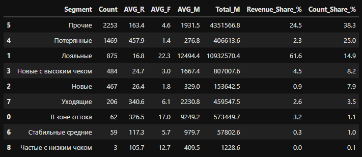
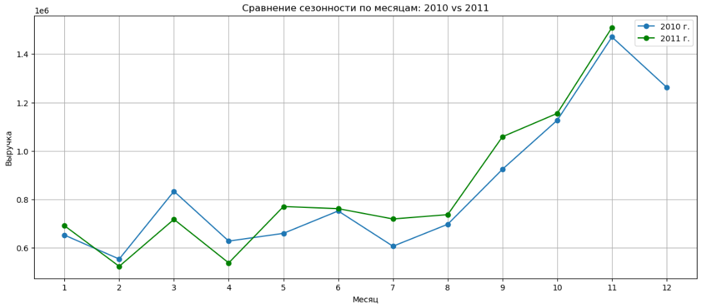
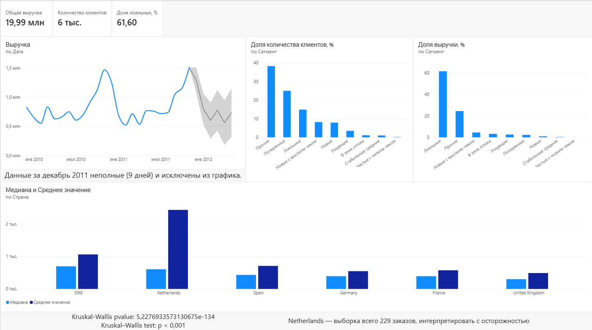

# Анализ клиентской базы интернет-магазина: RFM, статистика, тренд

Полный аналитический цикл (SQL → Python → статистика → Power BI) на данных о продажах британского интернет-магазина подарочных товаров за 2009–2011 годы.

**Ключевой результат:** 14.9% клиентов («Лояльные» по RFM-сегментации) приносят 61.6% всей выручки. Различия среднего чека между странами статистически подтверждены (Kruskal-Wallis, p ≈ 5.2×10⁻¹³⁴).

## Данные

Источник: [Online Retail II](https://archive.ics.uci.edu/dataset/502/online+retail+ii) (UCI ML Repository). ~1 млн транзакций британского интернет-магазина подарочных товаров, декабрь 2009 – декабрь 2011. Компания в основном работает с оптовыми покупателями.

Известные ограничения данных:
- часть строк без Customer ID
- встречаются служебные корректировки с отрицательной ценой при положительном количестве
- последний месяц данных неполный (9 дней вместо 31)

## Стек

SQL (MySQL) — агрегация, оконные функции, CTE. Python (pandas, scipy, matplotlib) — очистка, RFM-сегментация, статистические тесты. Power BI — дашборд.

## 1. Подготовка данных (SQL)

Три отдельные агрегации под разные задачи: выручка по странам на уровне счёта, выручка по месяцам для тренда, база для RFM по клиентам.

RFM-база строится через CTE с оконными функциями — Recency считается как разница между последней датой в данных и последней покупкой клиента, Monetary — суммой через `OVER (PARTITION BY)`. Frequency вынесен в отдельный CTE с `COUNT(DISTINCT Invoice)`, потому что MySQL не поддерживает `DISTINCT` внутри оконных функций:

```sql
with customer_revenue as
(select * from online_retail
 where Quantity > 0 and `Customer ID` is not null and Price > 0),
freq as
(select `Customer ID`, count(distinct Invoice) as F
 from customer_revenue
 group by `Customer ID`),
t as
(select `Customer ID`, InvoiceDate,
        max(InvoiceDate) over () as max_d,
        max(InvoiceDate) over (partition by `Customer ID`) as customer_m_d,
        sum(Quantity * Price) over (partition by `Customer ID`) as M
 from customer_revenue)
select distinct t.`Customer ID`,
       TIMESTAMPDIFF(DAY, t.customer_m_d, t.max_d) as R,
       freq.F,
       t.M
from t
join freq on t.`Customer ID` = freq.`Customer ID`
```

Условие `Price > 0` добавлено после обнаружения аномалии на этапе статистического анализа (см. пункт 3) — часть строк содержит служебные корректировки с отрицательной ценой при формально положительном количестве, которые искажали бы Monetary.

## 2. RFM-сегментация клиентов

Присвоил каждому клиенту оценки 1–5 по Recency, Frequency, Monetary через квантильное разбиение (`pd.qcut`). Для Frequency пришлось использовать `duplicates='drop'`, так как распределение сильно скошено — большая доля клиентов сделала всего одну покупку, из-за чего квантили давали повторяющиеся границы.

**Первая версия** сегментации (4 правила + категория «Прочие») оставила **42.9%** клиентов в «Прочих» — по сути, бесполезный результат для бизнеса:

```python
def segment(x):
    r, f, m = x['R_score'], x['F_score'], x['M_score']
    if r >= 4 and f >= 4 and m >= 4:
        return 'Лояльные'
    elif r <= 2 and f >= 4 and m >= 4:
        return 'В зоне оттока'
    elif r >= 4 and f <= 2:
        return 'Новые'
    elif r <= 2 and f <= 2 and m <= 2:
        return 'Потерянные'
    else:
        return 'Прочие'
```

**Доработанная версия** — добавил промежуточные правила («Уходящие», «Новые с высоким чеком», «Частые с низким чеком», «Стабильные средние»), чтобы каждая группа несла содержательный смысл:

```python
def segment(row):
    r, f, m = row['R_score'], row['F_score'], row['M_score']
    if r >= 4 and f >= 4 and m >= 4:
        return 'Лояльные'
    elif r <= 2 and f >= 4 and m >= 4:
        return 'В зоне оттока'
    elif r <= 2 and f >= 3 and m >= 3:
        return 'Уходящие'
    elif r >= 4 and f <= 2 and m >= 3:
        return 'Новые с высоким чеком'
    elif r >= 4 and f <= 2:
        return 'Новые'
    elif r <= 2 and f <= 2 and m <= 2:
        return 'Потерянные'
    elif f >= 4 and m <= 2:
        return 'Частые с низким чеком'
    elif r == 3 and f == 3 and m == 3:
        return 'Стабильные средние'
    else:
        return 'Прочие'
```

**Результат:**

| Сегмент | Доля клиентов | Доля выручки |
|---|---|---|
| Лояльные | 14.9% | **61.6%** |
| Прочие | 38.3% | 24.5% |
| Потерянные | 25.0% | 2.3% |
| Новые с высоким чеком | 8.2% | 4.5% |
| Новые | 7.9% | 0.9% |
| Уходящие | 3.5% | 2.6% |
| В зоне оттока | 1.1% | 3.2% |
| Стабильные средние | 1.0% | 0.3% |
| Частые с низким чеком | 0.1% | 0.0% |

Доля «Прочих» сократилась с 42.9% до 38.3% — осталась заметной, это честно признано в разделе «Ограничения» ниже, а не скрыто.

**Главный бизнес-вывод:** менее 15% клиентов формируют почти две трети выручки — усилия по удержанию стоит концентрировать на сегменте «Лояльные», а не распределять равномерно по всей базе.



## 3. Статистика: различается ли средний чек между странами

Отобрал топ-6 стран по количеству заказов и проверил гипотезу о равенстве среднего чека между ними.

**Обнаруженная аномалия:** при первом построении распределений выручки по счетам гистограмма по United Kingdom оказалась сильно растянута из-за одного счёта с выручкой 168 469. Разобрал причину в два шага:

1. Часть счетов имела отрицательную выручку — служебные корректировки, а не реальные продажи. Исключил их (`Revenue > 0`).
2. Счёт № 581483 содержал одну позицию товара («PAPER CRAFT, LITTLE BIRDIE») с количеством 80 995 штук — при проверке через SQL это оказалась единственная строка в счёте, что нетипично для легитимного опта (тот обычно распределён по многим позициям). Признал вероятной ошибкой ввода данных и исключил из анализа.


**Тест Левена:** statistic = 80.55, p ≈ 2.1×10⁻⁸⁴ → дисперсии между странами значимо неравны, условия для классической ANOVA не выполняются.

**Kruskal-Wallis:** statistic = 630.49, p ≈ 5.2×10⁻¹³⁴ → как минимум в одной стране медиана чека статистически значимо отличается от других.

**Пост-хок тест Данна** (с поправкой Бонферрони) показал, что United Kingdom статистически отличается от всех остальных рынков, а континентальная Европа (Germany, France, Spain) образует статистически близкую группу между собой — что согласуется с бизнес-моделью: UK — розничный рынок с высоким объёмом мелких заказов, остальные страны — преимущественно оптовые закупки.

| Страна | Медиана | Среднее | Кол-во заказов |
|---|---|---|---|
| United Kingdom | 300.41 | 484.55 | 36 535 |
| EIRE | 696.43 | 1 061.39 | 626 |
| Netherlands | 607.19 | 2 430.84 | 228 |
| Spain | 432.89 | 708.95 | 154 |
| Germany | 392.88 | 546.59 | 789 |
| France | 392.15 | 573.87 | 622 |

**Ограничение:** Netherlands представлена малой выборкой (228 заказов) и сильным разрывом между медианой и средним — интерпретирую с осторожностью.

## 4. Тренд выручки и сезонность

Помесячная динамика за 2010–2011 годы (декабрь 2011 исключён как неполный — данные всего за 9 дней). Сравнение по номеру месяца, а не по хронологии, показывает устойчивый сезонный паттерн: спад в начале года, рост к ноябрю.



Рост неравномерный: в феврале–апреле выручка 2011 года упала относительно того же периода 2010 (до −14.4%), тогда как июль–ноябрь дали уверенный рост (до +18.6%). Общая картина — не равномерный рост бизнеса, а усиление сезонного пика к концу года.

## Дашборд (Power BI)



## Ограничения и что сделал бы иначе

- Сегмент «Прочие» после доработки правил сегментации всё ещё составляет 38.3% клиентов — при наличии большего времени стоило бы ввести дополнительные подсегменты или перейти на кластеризацию (например, k-means по трём метрикам) вместо ручных пороговых правил
- Netherlands — малая выборка и сильный разброс, любые выводы по этой стране требуют осторожности
- Прогноз тренда в Power BI построен на 2 полных сезонных циклах — это формальный минимум для методов с учётом сезонности, доверительный интервал прогноза намеренно оставлен широким на дашборде

## Как воспроизвести

Данные: [Online Retail II на UCI](https://archive.ics.uci.edu/dataset/502/online+retail+ii). SQL-запросы — в папке `/sql`. Полный код с выводом каждой ячейки — в [notebook.ipynb](./notebook.ipynb).
